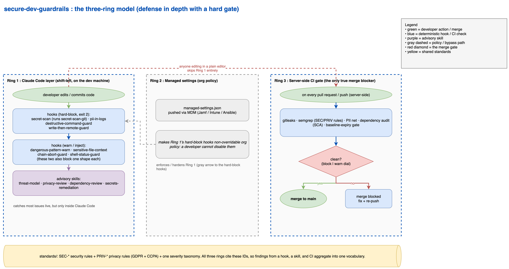

# secure-dev-guardrails

Security and privacy guardrails for a development org, built on Claude Code skills and hooks
plus a server-side CI gate. Targets GDPR + CCPA, the Python / JS-TS / Java-C# stack, and a
hybrid enforcement model (hard-block the unambiguous violations, warn on judgment calls).

The design rests on three rings, because no single mechanism can "ensure" compliance. See
[docs/three-ring-model.md](docs/three-ring-model.md).

Source: [docs/three-ring-flow.drawio](docs/three-ring-flow.drawio) (editable in draw.io).

## Layout

- `standards/`, the single source of truth. Security rules (SEC-*) including the
  authentication rules (SEC-AUTH-*), the API design rules (SEC-API-*), the CI and pipeline
  rules (SEC-CI-*), the runtime and detection rules (SEC-RUN-*), the container rules
  (SEC-CTR-*), the design-review trigger (SEC-DES-01), the attack-test rule (SEC-TEST-01),
  privacy rules (PRIV-*, GDPR + CCPA), AI and agent rules (SEC-AI-*) for systems where a model
  reads outside content or acts on its own, including the commands an assistant may run and
  the nine operations that always wait for a person (SEC-AI-STOP-01), the severity taxonomy,
  the suppression baseline, and the two org policy files that the skills here (and any
  external review plugin you point at them) read. Everything else cites these IDs.
  `framework-mapping.md` ties all 87 rules to NIST SSDF, the OWASP Top 10 2025, CWE, the OWASP LLM Top 10 2025, and GDPR/CCPA, so
  a rule can be defended in an audit rather than only asserted.
- `hooks/`, Claude Code hooks. `secret-scan.sh` and `pii-in-logs.sh` hard-block;
  `sensitive-file-context.sh` and `dangerous-pattern-warn.sh` warn/inject. Portable bash + jq,
  POSIX grep classes (run on BSD and GNU grep). Four Python hooks check every shell command
  before it runs (see "Shell-safety hooks" below).
- `settings/`, `managed-settings.json` (enterprise policy, non-overridable) and `install.sh`
  (push via MDM with admin rights).
- `ci/`, `security-privacy.yml` reusable GitHub Actions workflow, `.pre-commit-config.yaml`,
  the org `semgrep/` rule packs, `check-workflow-hardening.sh`, which reads the repo's own
  workflow files, and `check-kev.py`, which checks advisory ids against CISA's Known Exploited
  Vulnerabilities catalogue. This is the gate that actually blocks merges. It also holds
  `check-package-exists.py`, which the assistant and `dependency-review` run to confirm a
  package name on PyPI or npm.
- `skills/`, new skills (`privacy-review`, `threat-model`, `dependency-review`,
  `secrets-remediation`) and `enhancements/` (drop-in specs for `code-review`,
  `security-review`, a spec review skill, `architect`).
- `docs/`, the three-ring model, developer onboarding, and a worked example that takes one
  endpoint from unsafe to safe through the effort tiers and the self-check.

## Install (per machine / fleet)

1. **Hooks + managed settings:** `sudo settings/install.sh` (or push via MDM). It first checks
   for `jq`, `gitleaks` and a working `python3` and installs nothing if one is missing. Then it
   installs hooks to `/usr/local/share/secure-dev-guardrails/` and, last, the managed-settings
   policy to the OS path so developers cannot disable the hard blocks. Verify with
   `settings/install.sh --verify`, which checks that each hook is registered on the right
   event and matcher with the right command, and runs each Python hook once on a harmless
   call.
2. **Skills:** copy `skills/<name>/` into the team's Claude Code skills directory. Apply the
   `skills/enhancements/*.md` changes to the existing code-review / security-review / spec review
   / architect skills. Copy `skills/_shared/` to `~/.claude/skills/_shared/` too: the four
   skills read the Codex guide and runner from there.
   **Optional second model family.** threat-model, privacy-review, dependency-review and
   secrets-remediation can hand their analysis pass to an OpenAI model through the
   [Codex CLI](https://github.com/openai/codex) (`codex login` first; check with
   `python3 ~/.claude/skills/_shared/codex_delegate.py --check`). No Codex account? Set
   `{ "env": { "CODEX_REVIEW": "off" } }` in `~/.claude/settings.json`: the runner then exits 15,
   the analysis runs on Claude, and the document says `Codex review: off (CODEX_REVIEW=off)`.
3. **CI:** reference `ci/security-privacy.yml` from each repo's workflow and make the check
   Required in branch protection. Install pre-commit per clone for local feedback.
4. **Tooling:** `gitleaks` is required: without it the commit and push scan cannot run, so
   `secret-scan.sh` blocks every commit and push and says why, rather than letting an
   unscanned change through as if it were clean. `semgrep` is optional and adds coverage.
   `python3` must be on the machine, since the hooks call Python helpers: the secret scan
   uses `/usr/bin/python3` when present, else the `python3` on `PATH`. `jq` is required too.

## What is enforced where

- Hard-block (hook + CI): hardcoded secrets and credential files (SEC-SECRET-01/02), PII in logs
  (PRIV-LOG-01), real PII in fixtures (PRIV-ANON-01).
- Warn / review (hook + skills): injection, weak crypto, disabled TLS, dangerous patterns, and
  the privacy judgment calls (retention, deletion reachability, consent, transfers, subject
  rights).
- Outgoing requests, uploads and database accounts (owned at review, with patterns that
  assist): semgrep and the hook report a request value that becomes the URL of an outgoing
  request (SEC-WEB-03) and an archive unpacked without a recognised path filter
  (SEC-UPLOAD-01); the hook reports a database login as the superuser or owner (SEC-DB-01).
  Each rule's owner entry in `standards/security-standards.md` lists the shapes covered. The rest of each rule (address checks, pinning and redirects;
  content checks, size caps and where uploads are served from; migration and read-only
  accounts), and SEC-LOG-02 on forged log lines and security-event fields, are settled at
  review.
- Shell commands (hook only): a block on commands that destroy uncommitted work, on `rm -rf`
  outside temp and build folders, on a plain `git push --force`, and on calls where an early
  refusal or failure skips a file write; warnings on exit statuses that cannot be the work's and
  on zsh expansions that cancel a command. See "Shell-safety hooks" below.
- CI-only (needs a toolchain): SAST across the OWASP packs, SCA for known CVEs, license checks,
  baseline-expiry enforcement.
- Known exploited (SEC-DEP-04): `dependency-review` step 2b runs `ci/check-kev.py` over the
  advisory ids the SCA reported. A KEV listing outranks the CVSS score, because a score guesses
  how bad a flaw could be while a listing says somebody is exploiting it now, with a remediation
  date CISA sets. The script exits 2, never 0, when it cannot read the catalogue: a KEV check
  that reports clean because the network was down converts a look into a tick.
- Package names (SEC-DEP-05): a coding assistant can write a name for a package that was
  never published, and attackers register exactly those names. `ci/check-package-exists.py`
  asks PyPI and npm directly, by name, from a manifest or the command line, following `-r`
  and `-c` includes on disk. The org guidance file tells the assistant to run it before writing a new
  name, and `dependency-review` step 1b runs it over every added name. A missing name fails; a
  name first published in the last 90 days, or installed from a registry the project
  configures, is listed for a person to confirm; a registry that does not give a usable answer
  exits 2, never 0.
- Pipeline (CI + pre-commit): actions pinned to a commit SHA and a narrowed build token
  (SEC-CI-01/02). This one reports by default rather than blocking, and the reason is measured
  rather than polite: of the three repositories with workflow files on the machine this pack was
  written on, three fail the pinning rule and none fails the token rule. A gate that stops every
  existing repository on adoption day is removed by whoever meets it late in the day, so the
  `pin_actions` input starts at `warn` and a team flips it to `block` once its backlog is clear.
  An accepted action goes in `standards/baseline.yml` with an owner and an expiry.

## Shell-safety hooks

Four PreToolUse hooks on `Bash`, in Python with no third-party packages. Each reads the
command Claude Code is about to run and either blocks it (exit 2, the reason on stderr) or
adds a warning to the session (exit 0, JSON on stdout). Every block names a bypass for the
case where the command is intended: put the marker at the end of the command, unquoted. Never
put a marker in a command a person runs in their own shell, where no hook reads it.

- `destructive-command-guard.py` blocks `git reset --hard`, `git checkout -- <path>`,
  `git restore <path>` (including `--staged --worktree`) and `git clean -f` when the target tree
  has uncommitted changes, or when `git status` cannot be read there. It reads the git
  subcommand after wrappers, `VAR=value` and git's own options (`git -c k=v reset --hard`), and
  finds the tree from `git -C <path>` or an earlier `cd`, because with several sessions on one
  repository a dirty file is often another session's live work. It also blocks `rm -rf`
  outside the temp folders and regenerable build folders (the path is compared after `..` and
  symlinks are resolved), `rm -rf` on an unset bare variable
  or on the home folder, and a plain `git push --force`. The same discards on a clean tree,
  `--force-with-lease`, `git branch -D`, `git stash`, Docker and SQL deletes, and inline
  scripts that delete files only warn. A destructive string inside `grep` or `echo` is data,
  unless the command pipes it into a shell. List shared repositories in `PROTECTED_REPOS` to
  block resets and force-pushes there, on a clean tree too. Bypass: `#allow-destructive` or
  `CLAUDE_ALLOW_DESTRUCTIVE=1`.
- `write-then-remote-guard.py` blocks a call that creates a file and then, later in the same
  call, reaches a remote URL, a hosting API, a credential loader, `gh`, or `git add`,
  `commit` or `push`. When any part of a call is refused, nothing in it runs, so the file is
  never written and the next command fails on a file that does not exist. It also blocks a
  call that writes a script and then runs it when the script's body is the kind that gets
  refused (`rm -rf`, `sudo`, `git push`, SQL deletes). Write the file in one call and use it in
  the next. Add your own credential wrappers and hosts to `RISKY`. Bypass:
  `#allow-combined-write` or `CLAUDE_ALLOW_COMBINED_WRITE=1`.
- `chain-abort-guard.py` blocks a relative `cd` before a file write in an `&&` chain: the
  shell's directory carries over between calls, so the `cd` can fail and the write is then
  skipped. Each write is checked against its own `&&` chain. When zsh is the shell Claude Code
  uses (`CLAUDE_CODE_SHELL`, then `SHELL`), it also warns on zsh expansions that cancel a
  command before it runs: an unquoted glob before a write, a delete with two or more globs, an
  unquoted `--include=*.py`, a word that starts with `=` (`echo ====`), and a glob that matches
  nothing in the current folder.
  Bypass: `#allow-chain-write` or `CLAUDE_ALLOW_CHAIN_WRITE=1`.
- `shell-status-guard.py` warns when the status a command reports cannot be the status of the
  work: `$?` read after a pipe into `tail` or `head`, a background command piped into a
  display filter, work detached with a trailing `&` and no `wait`, a background or
  long-running command whose output goes to a file in a chain that ends on `tail` or
  `echo "EXIT=$?"`, a writer (`--apply`, `--push`) piped into
  `tail`, a `timeout` that is not installed, and `codex exec` with stdin left open. Under zsh
  it also warns on two zsh traps: `$NAME:path`, which zsh reads as a history modifier, and an
  unquoted `$VAR`, which zsh does not split into words. It blocks a `while` or `until` loop that waits
  on `pgrep -f` or `ps | grep`, because the waiting shell carries the same pattern and the loop
  never ends. Bypass: `#allow-shell-status` or `CLAUDE_ALLOW_SHELL_STATUS=1`.

Their tests are in `ci/tests/test_shell_safety_hooks_detections.py`, which runs with the other
detection tests (`python3 ci/tests/run_detection_tests.py`).

## The honest limit

**Detection has a deliberate hole and it is named rather than hidden.** SEC-RUN-01 to 03 make
detection something you design at threat-model time, test once so you know the alert fires, and
size against your log retention. They do NOT cover continuous container-level detection, meaning
container escape, cryptomining, reverse shells and anomalous process execution. That needs a
runtime protection platform and somebody watching it, and a rule assuming a security operations
team you do not have is a wish rather than a standard.

The two judgment-shaped pipeline rules are not enforced by anything: whether a workflow runs
untrusted code with credentials (SEC-CI-03), and whether an expression reaches a shell
(SEC-CI-04), are questions about how parts of a file relate, and a pattern match on either
produces noise. They belong to review, and the standards file says so beside each one.

This is defense in depth with a hard gate, not a guarantee. The hooks catch the unambiguous
cases, the skills surface the judgment calls, CI blocks the merge. Whether a field is needed for
its purpose, or a destination is an approved processor, stays a human decision (DPO, security
team). Do not describe the system as "ensuring" compliance on its own.

## Model routing

The skills in this pack pin a Claude Code model alias in their frontmatter, so each artifact runs on the tier its work needs:

- `model: fable`: planning and judgment-heavy review
- `model: opus`: execution and content work
- `model: sonnet`: routine or mechanical steps

If a pinned model is not available on your plan, or you prefer different routing, edit the `model:` line in the artifact's frontmatter, or delete it to inherit your session model.
